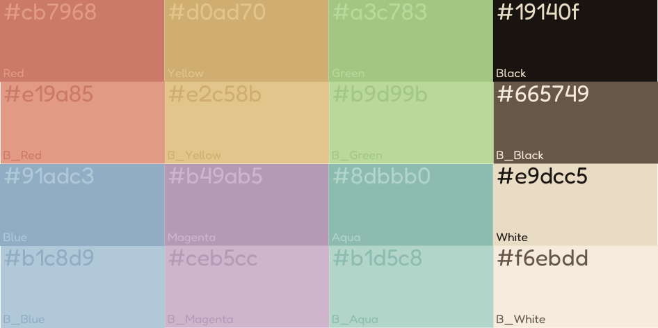
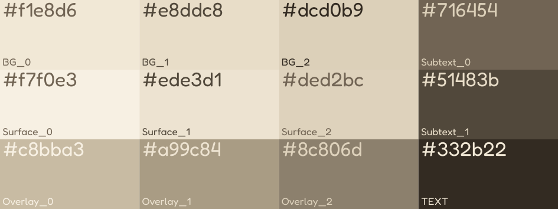
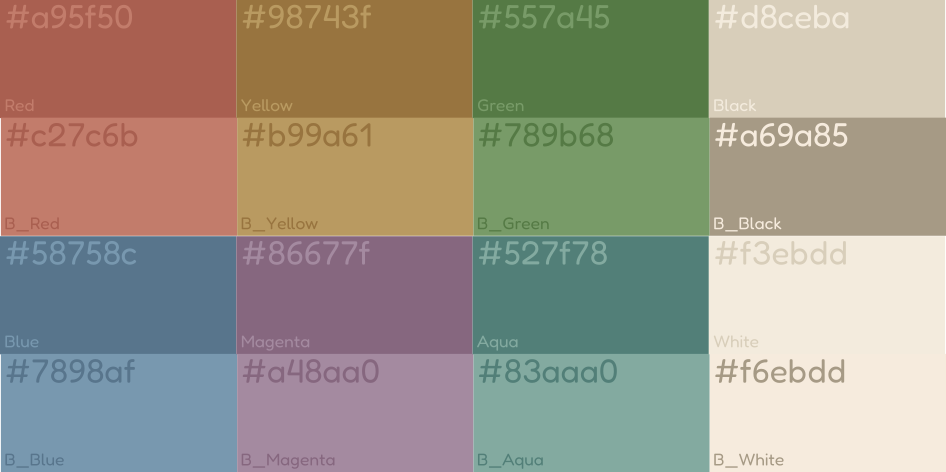
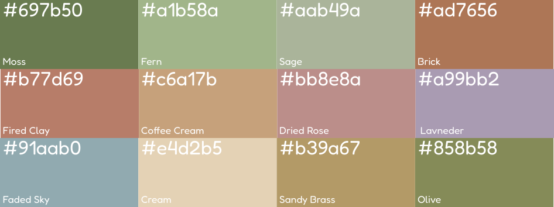

<h1 align="center">
Verdantica
</h1>

## Introduction
 Verdantica is a colorscheme inspirred by coffee, newsprint and botanical art, designed to be soft and comfortable. The color palette is divided into two themes: Solstice and Nocturne. Solstice evokes a fresh, vibrant, and bright feeling with soft tones, whereas Nocturne gives a relaxing, cozy feeling like a cup of coffee at night.

## Features
- Dark/Light theme
- Easy to customize
- Various color accents

## Inspirations
- [Gruvbox](https://github.com/morhetz/gruvbox)
- [Everforest](https://github.com/sainnhe/everforest/tree/master)
- Zacess Warm

## Preview
### Nocturne Base Colors:

|    Token   | BG_0          | BG_1           | BG_2          | Surface_0  | Surface_1      | Surface_2    |
|:----------:|---------------|----------------|---------------|------------|----------------|--------------|
|    Name    | Coffee Ground | Dark Roast     | Charcoal Husk | Espresso   | Roasted Walnut | Cocoa Husk   |
| Color Code | #241d18       | #1d1814        | #17130f       | #30251e    | #3c2e24        | #4a392c      |
|            |               |                |               |            |                |              |
|    Token   | Overlay_0     | Overlay_1      | Overlay_2     | Subtext_0  | Subtext_1      | Text         |
|    Name    | Coffee Ash    | Brown Mushroom | Weathered Oak | Warm Taupe | Oat Milk       | Cream Letter |
| Color Code | #655548       | #806d59        | #9b866e       | #b29f86    | #d3c2a8        | #f0e5d2      |

### Nocturne Accent Colors:

|    Token   | Black      | Red        | Green       | Yellow        | Blue         | Magenta   | Aqua    | White     |
|:----------:|------------|------------|-------------|---------------|--------------|-----------|---------|-----------|
|    Name    | Ink Shadow | Terracotta | Botanical   | Antique Brass | Slate Blue   | Mulberry  | Patina  | Newsprint |
| Color Code | #19140f    | #cb7968    | #a3c783     | #d0ad70       | #91adc3      | #b49ab5   | #8dbbb0 | #e9dcc5   |
|            |            |            |             |               |              |           |         |           |
|    Token   | B_Black    | B_Red      | B_Green     | B_Yellow      | B_Blue       | B_Magenta | B_Aqua  | B_White   |
|    Name    | Graphite   | Rosewood   | Spring Leaf | Toasted Gold  | Morning Blue | Heather   | Mist    | Ivory     |
| Color Code | #665749    | #e19a85    | #b9d99b     | #e2c58b       | #b1c8d9      | #ceb5cc   | #b1d5c8 | #f6ebdd   |

### Solstice Base Colors:

|    Token   | BG_0       | BG_1          | BG_2         | Surface_0   | Surface_1    | Surface_2 |
|:----------:|------------|---------------|--------------|-------------|--------------|-----------|
|    Name    | Newsprint  | Old Linen     | Kraft Shadow | Ivory Paper | Parchment    | Cardboard |
| Color Code | #f1e8d6    | #e8ddc8       | #dcd0b9      | #f7f0e3     | #ede3d1      | #ded2bc   |
|            |            |               |              |             |              |           |
|    Token   | Overlay_0  | Overlay_1     | Overlay_2    | Subtext_0   | Subtext_1    | Text      |
|    Name    | Paper Edge | Weathered Ink | Faded Print  | Walnut      | Printing Ink | Deep Ink  |
| Color Code | #c8bba3    | #a99c84       | #8c806d      | #716454     | #51483b      | #332b22   |

### Solstice Accent Colors:

### Bonus Accent Colors:

|    Token   | Black      | Red        | Green       | Yellow        | Blue         | Magenta   | Aqua    | White     |
|:----------:|------------|------------|-------------|---------------|--------------|-----------|---------|-----------|
|    Name    | Ink Shadow | Terracotta | Botanical   | Antique Brass | Slate Blue   | Mulberry  | Patina  | Newsprint |
| Color Code | #d8ceba    | #a95f50    | #557a45     | #98743f       | #58758c      | #86677f   | #527f78 | #f3ebdd   |
|            |            |            |             |               |              |           |         |           |
|    Token   | B_Black    | B_Red      | B_Green     | B_Yellow      | B_Blue       | B_Magenta | B_Aqua  | B_White   |
|    Name    | Graphite   | Rosewood   | Spring Leaf | Toasted Gold  | Morning Blue | Heather   | Mist    | Ivory     |
| Color Code | #a69a85    | #c27c6b    | #789b68     | #b99a61       | #7898af      | #a48aa0   | #83aaa0 | #f6ebdd   |

