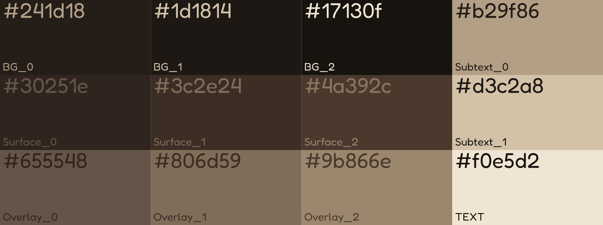

<h1 align="center">
Verdantica
</h1>

## Introduction
 Verdantica is a colorscheme inspirred by coffee, newsprint and botanical art, designed to be soft and comfortable. The color palette is divided into two themes: Solstice and Nocturne. Solstice evokes a fresh, vibrant, and bright feeling with soft tones, whereas Nocturne gives a relaxing, cozy feeling like a cup of coffee at night.

## Features
- Dark/Light theme
- Easy to customize
- Various color accents

## Inspirations
- [Gruvbox](https://github.com/morhetz/gruvbox)
- [Everforest](https://github.com/sainnhe/everforest/tree/master)
- Zacess Warm

## Preview
### Nocturne Base Colors:

### Nocturne Accent Colors:

### Solstice Base Colors:

### Solstice Accent Colors:

